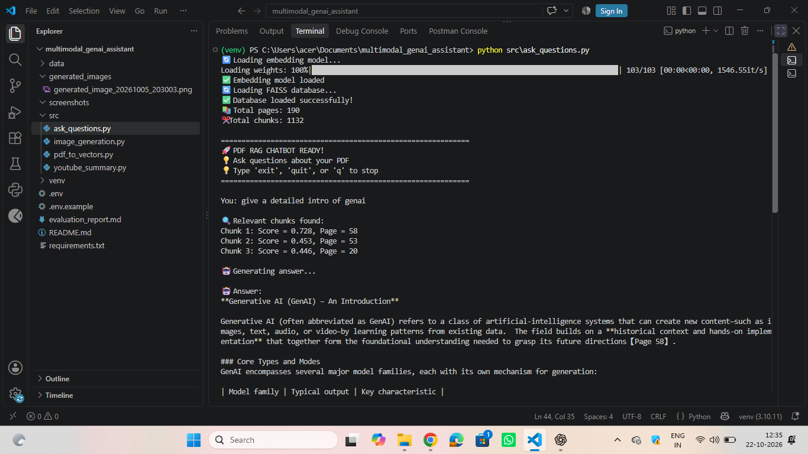
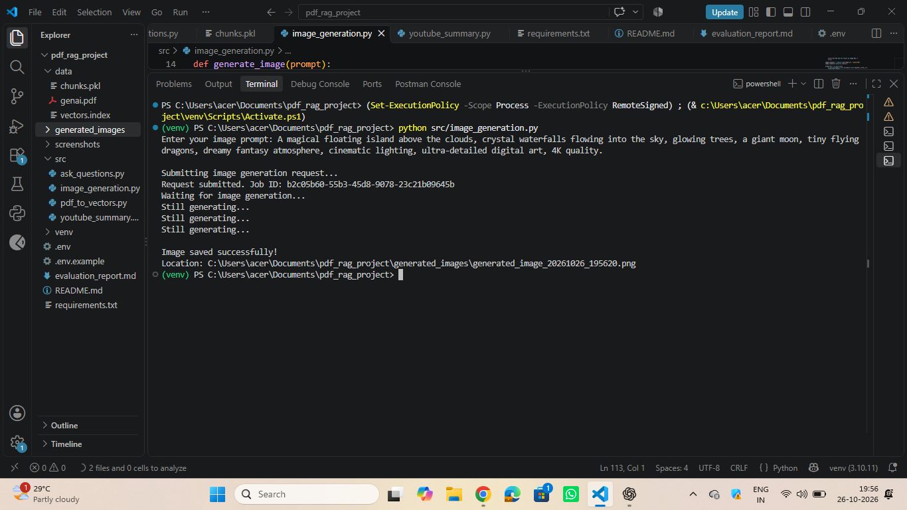
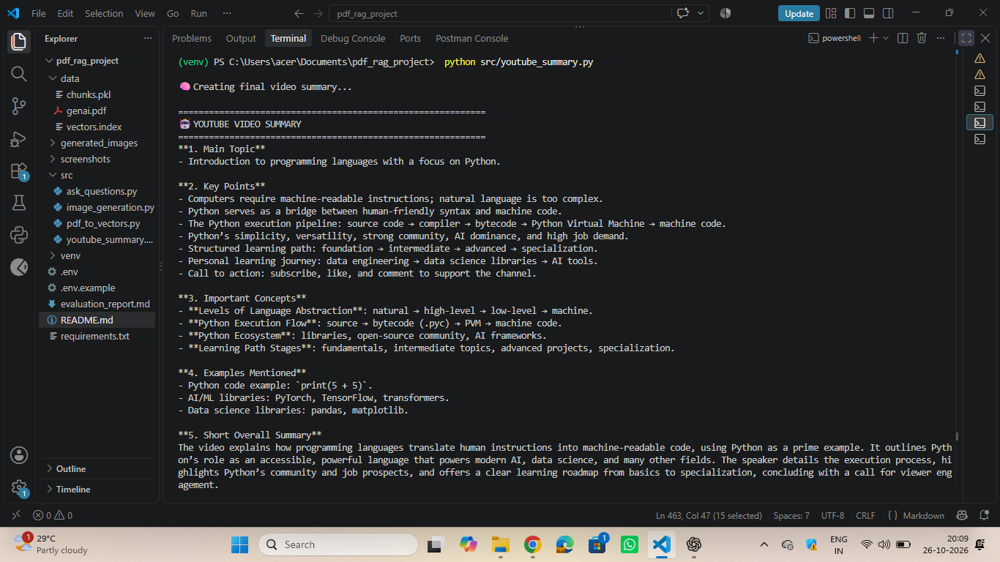

# 🤖 Multimodal GenAI Assistant

A Python-based **Multimodal Generative AI application** that combines **Retrieval-Augmented Generation (RAG), Large Language Models (LLMs), text-to-image generation, and YouTube video summarization** into a single project.

The system allows users to interact with PDF documents, generate images from text prompts, and summarize YouTube videos.

---

## 🚀 Features

### 📄 1. PDF Question Answering using RAG

* Extracts text from PDF documents.
* Splits documents into smaller chunks.
* Generates vector embeddings using **Sentence Transformers**.
* Stores embeddings using **FAISS**.
* Retrieves the most relevant chunks for a user query.
* Uses an LLM to generate an answer based only on the retrieved context.
* Displays the relevant PDF page information.

### 🎨 2. Text-to-Image Generation

* Accepts a natural-language image prompt.
* Uses **Hugging Face Inference Providers** for image generation.
* Uses the **FLUX.1-dev** image-generation model.
* Automatically saves generated images locally.
* Generated images are stored inside the `generated_images` folder.

Example:

```text
User:
"A futuristic city with flying cars at night"

        ↓

Hugging Face Image Model

        ↓

Generated Image

        ↓

generated_images/
```

### ▶️ 3. YouTube Video Summarization

* Accepts a YouTube video URL.
* Extracts the available transcript.
* Processes the transcript into manageable chunks.
* Uses an LLM to summarize the content.
* Produces a concise summary of the video.

> Note: The current implementation summarizes the **available transcript**. It does not directly analyze the visual frames of the video.

---

# 🏗️ Project Architecture

```text
                    MULTIMODAL GENAI ASSISTANT
                              │
              ┌───────────────┼────────────────┐
              │               │                │
              ▼               ▼                ▼
           PDF RAG       IMAGE GENERATION   YOUTUBE
              │               │                │
              ▼               ▼                ▼
         PDF Text         Text Prompt       Video URL
              │               │                │
              ▼               ▼                ▼
          Chunking        HF Inference      Transcript
              │               │                │
              ▼               ▼                ▼
       SentenceTransformer   FLUX.1-dev      Chunking
              │               │                │
              ▼               ▼                ▼
            FAISS        Generated Image       LLM
              │                                │
              ▼                                ▼
          Retrieved                         Summary
           Context
              │
              ▼
           Groq LLM
              │
              ▼
          Final Answer
```

---

# 📁 Project Structure

```text
pdf_rag_project/
│
├── src/
│   ├── pdf_to_vectors.py
│   ├── ask_questions.py
│   ├── image_generation.py
│   └── youtube_summary.py
│
├── documents/
│   └── *.pdf
│
├── generated_images/
│   └── generated_image_*.png
│
├── .env
├── .gitignore
├── requirements.txt
├── README.md
│
├── vectors.index
└── chunks.pkl
```

---

# 🛠️ Technologies Used

* **Python**
* **Generative AI**
* **Large Language Models (LLMs)**
* **Retrieval-Augmented Generation (RAG)**
* **FAISS**
* **Sentence Transformers**
* **Vector Embeddings**
* **Hugging Face Inference Providers**
* **FLUX.1-dev**
* **Groq API**
* **YouTube Transcript API**
* **PyPDF2**
* **NumPy**
* **Python-dotenv**

---

# 🧠 RAG Pipeline

The PDF question-answering component follows this pipeline:

```text
PDF
 ↓
Text Extraction
 ↓
Text Chunking
 ↓
Sentence Transformer
 ↓
Vector Embeddings
 ↓
FAISS Index
 ↓
User Query
 ↓
Query Embedding
 ↓
Similarity Search
 ↓
Relevant Chunks
 ↓
Groq LLM
 ↓
Final Answer
```

### Embedding Model

```text
all-MiniLM-L6-v2
```

### Vector Database

```text
FAISS
```

### Similarity Search

The project uses **inner-product similarity** with normalized embeddings.

---

# 🎨 Image Generation Pipeline

```text
User Text Prompt
       ↓
image_generation.py
       ↓
Hugging Face InferenceClient
       ↓
FLUX.1-dev
       ↓
Generated Image
       ↓
PNG File
       ↓
generated_images/
```

Example prompt:

```text
A futuristic city with flying cars,
neon lights, skyscrapers and cinematic
lighting at night
```

---

# ▶️ YouTube Summarization Pipeline

```text
YouTube URL
     ↓
Extract Video ID
     ↓
YouTube Transcript
     ↓
Text Chunking
     ↓
LLM
     ↓
Video Summary
```

---

# ⚙️ Installation

## 1. Clone the repository

```bash
git clone <YOUR_GITHUB_REPOSITORY_URL>
```

Move into the project directory:

```bash
cd pdf_rag_project
```

---

## 2. Create a virtual environment

```bash
python -m venv venv
```

Activate it on Windows:

```powershell
.\venv\Scripts\Activate.ps1
```

---

## 3. Install dependencies

```bash
pip install -r requirements.txt
```

---

# 🔑 Environment Variables

Create a `.env` file in the project root:

```env
GROQ_API_KEY=your_groq_api_key
HF_TOKEN=your_huggingface_token
```

### Important

Never upload your `.env` file to GitHub.

Add the following to `.gitignore`:

```text
.env
venv/
__pycache__/
*.pyc
```

---

# ▶️ How to Run

## 📄 PDF RAG

First create the FAISS vector index:

```powershell
python src\pdf_to_vectors.py
```

Then start the question-answering system:

```powershell
python src\ask_questions.py
```

You can then ask questions about the PDF.

Example:

```text
Enter your question:
What is Generative AI?
```

---

## 🎨 Image Generation

Run:

```powershell
python src\image_generation.py
```

Enter a prompt:

```text
Enter your image prompt:
A futuristic city with flying cars at night
```

The generated image will be saved in:

```text
generated_images/
```

---

## ▶️ YouTube Summarization

Run:

```powershell
python src\youtube_summary.py
```

Then provide a YouTube URL:

```text
Enter YouTube URL:
https://www.youtube.com/watch?v=XXXXXXXXXXX
```

The application extracts the available transcript and generates a summary.

---

# 🔐 API Keys

This project uses:

### Groq

Used for:

* PDF question answering
* LLM-based processing
* YouTube summarization

### Hugging Face

Used for:

* Text-to-image generation

No API keys should be hard-coded into Python files.

---

# 📌 Example Use Cases

### 📚 Document Assistant

Ask questions about:

* Study materials
* Company policies
* Technical documentation
* Research papers
* Project documents

### 🎨 AI Image Generator

Generate images from natural-language descriptions.

### 🎥 Video Summarizer

Quickly understand the key information from YouTube videos with available transcripts.

---

# 🔮 Future Enhancements

Planned improvements include:

* [ ] Multi-PDF RAG
* [ ] Version-aware document retrieval
* [ ] Metadata-based retrieval
* [ ] Reranking
* [ ] Hybrid search
* [ ] Conversation memory
* [ ] Streaming LLM responses
* [ ] Web interface using Streamlit
* [ ] FastAPI backend
* [ ] Multimodal PDF understanding
* [ ] YouTube visual-frame analysis
* [ ] AI Agent integration
* [ ] RAG evaluation
* [ ] Deployment to cloud

---

# 🎯 Skills Demonstrated

This project demonstrates practical experience with:

* Python programming
* API integration
* LLM integration
* Prompt engineering
* Retrieval-Augmented Generation
* Vector databases
* Semantic search
* Embeddings
* PDF processing
* Text-to-image generation
* YouTube transcript processing
* Environment variable management
* Modular project structure
* Git and GitHub

---


## 📸 Project Screenshots

### 1. PDF Question Answering using RAG


### 2. AI Image Generation


### 3. YouTube Video Summarization



# 👩‍💻 Author

**Abinaya K**

B.E. Computer Science and Engineering

Interested in:

* Artificial Intelligence
* Generative AI
* Prompt Engineering
* RAG
* AI Agents
* Machine Learning
* AI Application Development

---

## ⭐ Future Vision

The goal of this project is to evolve it into a complete **AI-powered multimodal assistant** capable of understanding documents, generating and understanding visual content, processing videos, and interacting with users through a unified AI interface.
